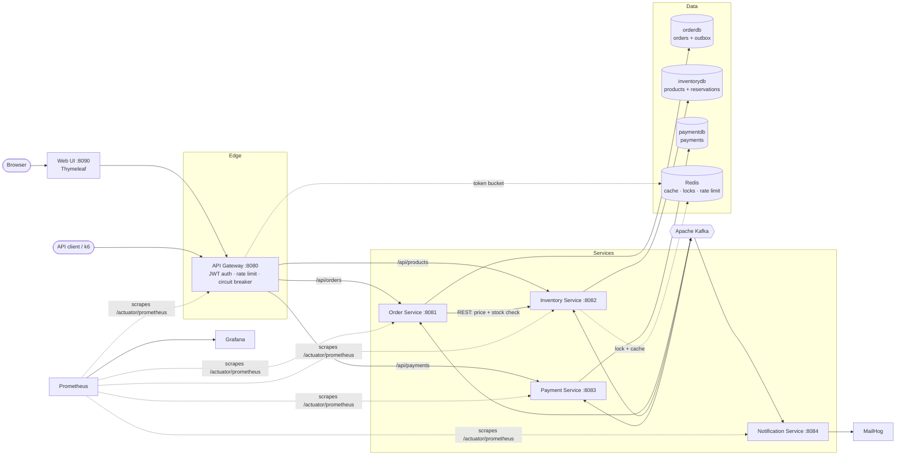
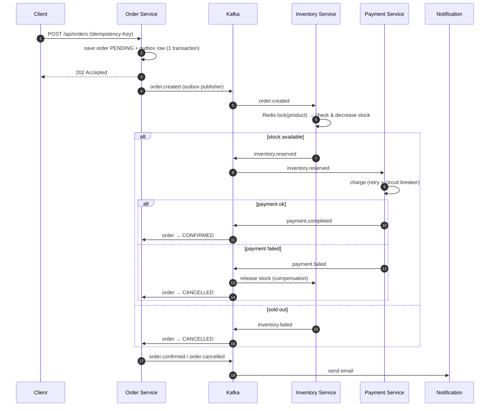

# Flash Sale – Event-Driven Order Processing (Spring Boot Microservices)

A flash-sale backend where thousands of buyers race for a few units of a product.
It is built to show how real distributed-system problems are solved in Java:
**no overselling, no double charges, no lost events, and graceful failure.**

**Stack:** Java 21 · Spring Boot 3.5 · Spring Cloud Gateway · Apache Kafka · PostgreSQL · Redis · Resilience4j · Flyway · Testcontainers · Prometheus · Grafana · Docker Compose · GitHub Actions · k6

---

## Architecture



Each service owns its own database (**database-per-service**). Services talk to each other through Kafka events; the only synchronous call is Order → Inventory for the current price.

### Order saga (choreography)



---

## Key design decisions (interview talking points)

| Problem | Solution | Where |
|---|---|---|
| 1,000 buyers, 10 units: **overselling** | Redis distributed lock per product (works across instances) + JPA `@Version` + DB `CHECK (available_stock >= 0)` as three layers of defence. Lock is released only after the DB commit. | `StockReservationService` |
| **Distributed transaction** across order, stock and payment | Saga (choreography) with a compensating action: payment failure releases stock | all services |
| Order saved but Kafka down → **lost event** | Transactional Outbox: event row is written in the same DB transaction; a poller publishes it with `FOR UPDATE SKIP LOCKED` so several instances can run | `outbox` package |
| User double-clicks "Buy" / network retry → **duplicate order** | `Idempotency-Key` header + unique DB index; race handled by catching the constraint violation | `OrderService` |
| Kafka delivers a message twice → **double charge / double reservation** | Idempotent consumers: `reservations` keyed by orderId, `payments.order_id` unique; duplicates replay the stored outcome | inventory, payment |
| Inventory or payment provider **down** | Resilience4j retry (transient errors only) + circuit breaker + fallback; gateway returns 503 via fallback route | `ProductClient`, `MockPaymentGateway`, gateway |
| **Poison message** blocks a partition | `DefaultErrorHandler`: 3 retries, then dead-letter topic; bad JSON goes straight to DLT | `KafkaConfig` in each service |
| Bots / one user flooding the API | Redis token-bucket rate limiter per user at the gateway | `api-gateway` |
| Hot product page during the sale | Redis cache (`@Cacheable`), evicted whenever stock changes | `ProductService` |
| Spoofed identity headers | Gateway strips `X-User-Id` / `X-User-Roles` from every incoming request and sets them only from a valid JWT | `JwtAuthenticationFilter` |

**Trade-offs worth mentioning:** the order service uses a full outbox; inventory and payment publish *after commit* and rely on idempotent replay when a publish fails (simpler, still at-least-once). Emails are at-least-once, so a rare duplicate email is accepted. Choreography is simple for 4 services; with many more steps an orchestrator (e.g. a dedicated saga service) would be easier to follow.

---

## Run it

**Requirements:** Docker Desktop, Java 21 and Maven (only for running tests or services from the IDE).

```bash
docker compose up -d --build
```

| What | URL |
|---|---|
| **Web UI (start here)** | http://localhost:8090 |
| API Gateway | http://localhost:8080 |
| Swagger (order / inventory / payment) | http://localhost:8081/swagger-ui.html · :8082 · :8083 |
| MailHog inbox | http://localhost:8025 |
| Prometheus | http://localhost:9090 |
| Grafana (admin / admin) | http://localhost:3000 — import dashboard **4701** (JVM Micrometer) |

Run services from IntelliJ instead: `docker compose up -d postgres redis kafka mailhog`, then start each `*Application` class. Defaults point to `localhost`.

### Try the flow in the browser

1. Open http://localhost:8090 and log in as `alice / alice123`.
2. Open a product and click **Buy now**. You land on the order page, which shows the saga steps and refreshes every 2 seconds until the order is **CONFIRMED** or **CANCELLED**.
3. Buy 4 × "Flash Deal Smartphone" (₹59,996, above the ₹50,000 card limit) to watch a payment fail, the stock come back and the order get cancelled.
4. Open http://localhost:8025 to read the confirmation/cancellation emails.
5. Log in as `admin / admin123` → **Admin** to create products or add stock (normal users get "Not allowed").

The Web UI is a separate Spring Boot service (Thymeleaf, server-side rendered). It only talks to the **API gateway**, never to a service or database directly. It keeps the JWT in the HTTP session, sends a fresh `Idempotency-Key` with every Buy form (so a double-click creates one order), and joins order rows with product names in memory (API composition).

### Try the flow with curl

```bash
# 1. Login (demo users: admin/admin123, alice/alice123, bob/bob123)
TOKEN=$(curl -s -X POST localhost:8080/auth/login -H 'Content-Type: application/json' \
  -d '{"username":"alice","password":"alice123"}' | jq -r .accessToken)

# 2. Browse products (public)
curl -s localhost:8080/api/products | jq

# 3. Place an order
curl -s -X POST localhost:8080/api/orders \
  -H "Authorization: Bearer $TOKEN" -H 'Content-Type: application/json' \
  -H "Idempotency-Key: $(uuidgen)" \
  -d '{"productId":1,"quantity":1,"customerEmail":"alice@example.com"}' | jq

# 4. Check the status (PENDING -> CONFIRMED / CANCELLED within ~1s)
curl -s localhost:8080/api/orders -H "Authorization: Bearer $TOKEN" | jq
```

**See compensation:** order 4 × product 1 (₹59,996 > ₹50,000 card limit) → payment is declined, stock goes back, order is CANCELLED, and a cancellation email appears in MailHog.

**See idempotency:** send the same request twice with the same `Idempotency-Key` → second call returns `200` with the same order id.

**Admin (RBAC):** login as `admin`, then `POST /api/products` or `PUT /api/products/{id}/stock`. A normal user gets `403`.

---

## Tests

```bash
mvn verify      # Docker must be running (Testcontainers)
```

| Test | What it proves |
|---|---|
| `StockReservationConcurrencyTest` | 50 concurrent buyers, 10 units → exactly 10 reserved, stock 0, never negative; duplicate events reserve once; compensation releases once |
| `OrderServiceIntegrationTest` | Idempotency key creates one order; outbox event reaches Kafka; `payment.completed` confirms the order (real Postgres + Kafka) |
| `PaymentServiceTest` | Declined → FAILED + `payment.failed`; duplicate event never charges twice |
| `JwtServiceTest`, `EmailServiceTest` | Token validation (tampered/foreign tokens rejected), email content |
| `WebUiTest` | Public product page, login redirect, Buy sends the idempotency key, sold-out message, pending page auto-refresh, admin page blocked for users |

## Load test

```bash
RATE_LIMIT_REPLENISH=1000 RATE_LIMIT_BURST=2000 docker compose up -d api-gateway
k6 run loadtest/flash-sale.js
```

Ramps to **200 orders/sec** on a 50-unit product. Record p95 latency, accepted vs sold-out counts and final stock (must be ≥ 0) in the table below.

| Metric | Result |
|---|---|
| Peak throughput | _fill in_ req/s |
| p95 latency | _fill in_ ms |
| Orders accepted / sold out | _fill in_ |
| Final stock | _fill in_ (never negative) |

## Deploy to AWS (EC2, simplest path)

1. Launch an EC2 instance (t3.medium or larger), open ports 22 and 8080 in the security group.
2. Install Docker and the Compose plugin, clone the repo.
3. Set a real secret: `export JWT_SECRET=$(openssl rand -hex 32)`
4. `docker compose up -d --build`
5. Next steps: push images to ECR, run on ECS, move Postgres to RDS and Redis to ElastiCache.

## Project structure

```
flash-sale/
├── common/                 shared Kafka event records + topic names
├── api-gateway/            routing, JWT, rate limiting, circuit breaker fallback
├── order-service/          orders, idempotency, outbox, saga state
├── inventory-service/      products, Redis lock + cache, reservations, compensation
├── payment-service/        mock gateway, retry/circuit breaker, idempotent charges
├── notification-service/   Kafka → Thymeleaf email (MailHog)
├── web-ui/                 Thymeleaf frontend: login, products, buy, live order status, admin
├── docker/                 Postgres init, Prometheus, Grafana provisioning
├── loadtest/               k6 script
└── .github/workflows/      CI: build, Testcontainers tests, Docker images
```
